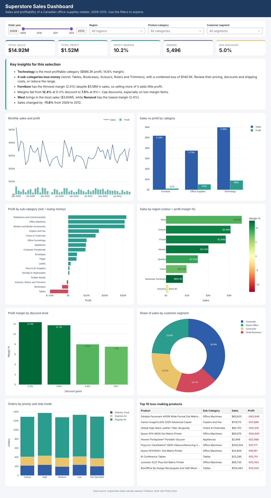

# EliteTech Internship – Data Analytics Tasks

| | |
|---|---|
| **Company** | EliteTech Intern |
| **Name** | Hitesh Kumar |
| **Intern ID** | ETI-AO-10004100962 |
| **Domain** | Data Analytics (Virtual Internship) |
| **Duration** | 8 weeks (16 October 2026 – 15 December 2026) |

This repository contains all **four** tasks of the EliteTech Data Analytics internship. Every notebook is fully commented, has already been run (outputs and charts are visible on GitHub), and uses a real public dataset.

| # | Task | Tools | Dataset | Deliverable |
|---|------|-------|---------|-------------|
| 1 | [Big Data Analysis](Task1_Big_Data_Analysis/big_data_analysis_dask.ipynb) | **Dask**, Parquet | Our World in Data COVID-19 (429K rows × 67 cols) | Notebook with insights + scalability tests |
| 2 | [Predictive Analysis using ML](Task2_Predictive_Analysis/churn_prediction_ml.ipynb) | scikit-learn | IBM Telco Customer Churn (7,043 customers) | Notebook: feature selection, training, evaluation |
| 3 | [Dashboard Development](Task3_Dashboard/app.py) | **Plotly Dash** | Superstore Sales (8,399 orders) | Interactive dashboard with actionable insights |
| 4 | [Sentiment Analysis](Task4_Sentiment_Analysis/sentiment_analysis_nlp.ipynb) | NLTK, scikit-learn | Twitter US Airline Sentiment (14,640 tweets) | Notebook: preprocessing, models, insights |

---

## Task 1: Big Data Analysis (Dask)

Analyses daily COVID-19 records for 237 countries with **Dask**. Dask splits the data into partitions and processes them in parallel and lazily, so the same code scales from a laptop to a cluster.

**What it shows**
- Partitioned CSV reading, filtering, group-bys and time-series aggregation in Dask
- **Scalability tests:**
  - Converting CSV → **Parquet** made the data **7× smaller** and the query **~5× faster**
  - Making the data **8× larger (3.4M rows) made the query only ~4.6× slower**, and throughput rose as the data grew
  - Using all CPU cores instead of one made the query faster

**Key insights**
- Reported cases peaked in **January 2022** (Omicron); deaths peaked in **January 2021**.
- The case fatality rate fell from **~2.4% (2020) to ~0.3% (2022)**.
- **South America, Europe and North America** have the highest deaths per million. **Peru** tops the country ranking.
- Deaths per million correlate strongly with **older populations** (r ≈ 0.69 with % aged 65+).

## Task 2: Predictive Analysis using Machine Learning

A classification model that predicts which telecom customers will **churn**.

**Pipeline:** data cleaning → EDA → feature engineering (number of services, average spend, new-customer flag) → one-hot encoding → **feature selection** (mutual information + RFECV, 33 → 25 features) → **3 models** (Logistic Regression, Random Forest, Gradient Boosting) with 5-fold CV → test-set evaluation (accuracy, precision, recall, F1, ROC-AUC, ROC curves, confusion matrices) → **GridSearchCV tuning** → saved model (`churn_model.joblib`).

**Results:** the tuned Logistic Regression reaches **ROC-AUC 0.84** on the test set and catches **80% of churners** (recall).

**Key insights:** month-to-month contracts, short tenure, fiber-optic internet, electronic-check payment and missing tech support/security are the biggest churn drivers. The notebook ends with retention recommendations.

## Task 3: Dashboard Development (Plotly Dash)



An interactive sales dashboard. **Filters** (year range, region, category, segment) update every element:
- **KPI cards:** sales, profit, margin, orders, average discount
- **Key insights panel**, generated automatically from the filtered data
- Monthly sales and profit trend, category comparison, profit by sub-category (losses in red), sales by region coloured by margin, margin by discount level, segment share, orders by priority and ship mode, and the top 10 loss-making products

**Actionable insights (all data)**
- **Technology** earns the most profit (14.8% margin). **Furniture** sells $5.2M but makes only a 2.3% margin.
- **Tables, Bookcases, Scissors/Rulers and Rubber Bands lose money** (−$140K combined). Review their pricing and discounts.
- Margin drops from **12.4% at 0–2% discount to 7.5% at 9%+**. Cap discounts on low-margin products.
- **West** is the biggest region by sales; **Nunavut** has the lowest margin.

**Run it**
```bash
cd Task3_Dashboard
python app.py
# open http://127.0.0.1:8050 in your browser
```

## Task 4: Sentiment Analysis (NLP)

Classifies airline tweets as **negative / neutral / positive**.

**Pipeline:** EDA → text preprocessing (remove URLs and mentions, lower-case, negation-aware stop-word removal, lemmatisation) → **VADER** lexicon baseline → **TF-IDF (unigrams + bigrams)** with Naive Bayes, Logistic Regression and Linear SVM → GridSearchCV tuning → confusion matrices, top predictive words, error analysis → business insights.

| Model | Accuracy | Macro-F1 |
|---|---|---|
| VADER (rule-based) | 0.54 | 0.51 |
| Naive Bayes | 0.71 | 0.53 |
| Logistic Regression | 0.77 | 0.72 |
| **Linear SVM (tuned)** | **0.78** | **0.72** |

**Key insights:** 63% of tweets are negative. **Customer service** (32%) and **late flights** (18%) are the top complaints. **US Airways, American and United** have the worst net sentiment, while **Virgin America** has the best.

---

## How to run

```bash
# 1. Clone the repository
git clone <your-repo-url>
cd elitetech-data-analytics

# 2. Install the dependencies (Python 3.10+)
pip install -r requirements.txt

# 3. Open the notebooks
jupyter notebook
```

- **Task 1** downloads its ~100 MB dataset automatically on the first run. It is too big to store on GitHub.
- **Task 4** downloads the NLTK resources it needs automatically on the first run.
- All other datasets are in the `data/` folder.

## Repository structure

```
elitetech-data-analytics/
├── README.md
├── requirements.txt
├── data/
│   ├── telco_churn.csv          # Task 2
│   ├── superstore_sales.csv     # Task 3
│   └── airline_tweets.csv       # Task 4
├── Task1_Big_Data_Analysis/
│   └── big_data_analysis_dask.ipynb
├── Task2_Predictive_Analysis/
│   ├── churn_prediction_ml.ipynb
│   └── churn_model.joblib
├── Task3_Dashboard/
│   ├── app.py
│   └── dashboard_screenshot.png
└── Task4_Sentiment_Analysis/
    └── sentiment_analysis_nlp.ipynb
```

## Data sources
- COVID-19: [Our World in Data](https://github.com/owid/covid-19-data) (CC BY 4.0)
- Telco churn: [IBM sample data](https://github.com/IBM/telco-customer-churn-on-icp4d)
- Superstore sales: Tableau sample dataset ([mirror](https://github.com/curran/data/tree/gh-pages/superstoreSales))
- Airline tweets: [Crowdflower / Kaggle – Twitter US Airline Sentiment](https://www.kaggle.com/datasets/crowdflower/twitter-airline-sentiment)
